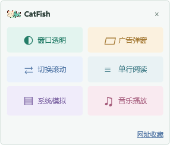
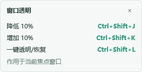
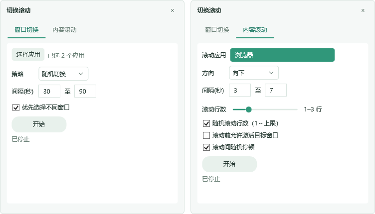
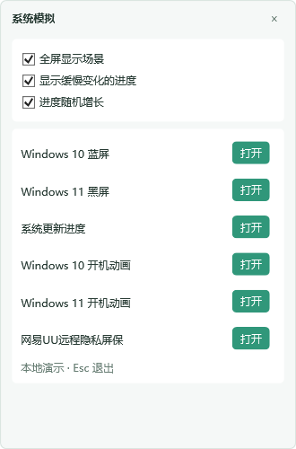
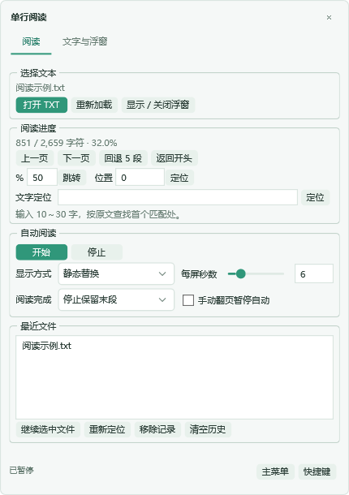
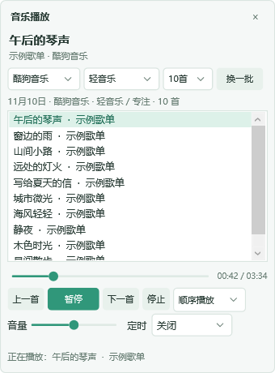
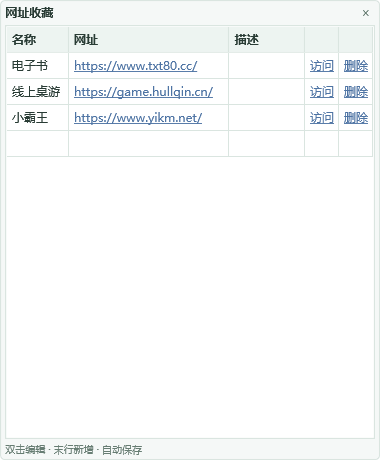

# CatFish

CatFish 是一款基于 C# 和 WPF 的 Windows 桌面工具，集成了窗口管理、单行阅读、音乐播放和网址收藏等功能。

## 运行环境

- **系统** Windows 10 或 Windows 11（x64）。
- **运行发布版** 需要 .NET 9 桌面运行时（x64）。[微软官方下载页](https://dotnet.microsoft.com/zh-cn/download/dotnet/9.0)
- **从源码开发** 需要 .NET 9 SDK。

完整解压发布包，保留同目录的 DLL 和 JSON 文件，再双击 `CatFish.exe`。如果缺少桌面运行时，点「是」打开微软官方下载页，点「否」退出。更新程序前，请先从托盘退出旧版本。

## 功能介绍

### 窗口透明

选中要调整的窗口，按 `Ctrl + Shift + J` 或 `Ctrl + Shift + K`，每次降低或提高 10 个百分点的不透明度。按 `Ctrl + Shift + L` 一键切换，完全不透明的窗口会变为 40% 不透明度，低于 100% 的窗口会恢复到 100%。

### 切换滚动

在「窗口切换」中选择多个应用，可以按指定的时间间隔随机或顺序切换，也可以选手动模式。在「内容滚动」中选择一个目标窗口，设置向上、向下或交替滚动，并调整每次滚动的行数和停顿时间。

### 系统模拟

可以演示 Windows 10 蓝屏、Windows 11 黑屏、系统更新进度、Windows 10 和 Windows 11 开机动画，以及网易 UU 远程隐私屏保。开机动画会循环播放，隐私屏保是本地界面演示。设置页和托盘都能打开这些场景，可选全屏显示，按 `Esc` 退出。

### 广告弹窗

把已打开的应用窗口拖到弹窗上，或用「选择」嵌入目标窗口。可以指定显示器、角落、尺寸和弹出时间，也能调整背景透明度、边缘遮罩和模糊程度。

支持抖音、腾讯视频、爱奇艺、优酷等主流平台

内置 6 款背景，按原图比例显示。解锁宽高后可自由调整窗口尺寸，GIF 背景在预览和弹窗中循环播放，边缘遮罩随背景更新。

### 单行阅读

打开或拖入 TXT 文件，把文字放到单行浮窗里阅读。支持静态翻页和平滑滑动，可调整字体、颜色、透明度、速度和浮窗位置。程序会保存阅读进度，也可以从最近打开的文件中继续阅读。

### 音乐播放

可以从本地文件夹（含子文件夹）载入歌曲，也可以切换酷狗、网易云和一听，收听公开的在线曲目。支持按风格选歌、顺序或随机播放、列表或单曲循环，以及音量调节和定时停止。

### 网址收藏

从主界面右下角打开，默认提供「电子书」「线上桌游」「小霸王」三个网站。双击单元格可编辑名称、网址和描述，在最后一行可新增。点「访问」用默认浏览器打开，删除后可在窗口底部点「撤销」恢复刚删除的条目。

## 托盘与快捷键

关闭主窗口会收起到系统托盘。要退出程序，请在托盘菜单中选择退出。右键点击主窗口可以打开快捷键设置。

按 `Ctrl + Shift + X` 紧急停止时，程序会先停止各子功能，再关闭子窗口并将主界面收起到托盘，同时恢复窗口外观。广告弹窗中选中的应用会收到关闭请求。

